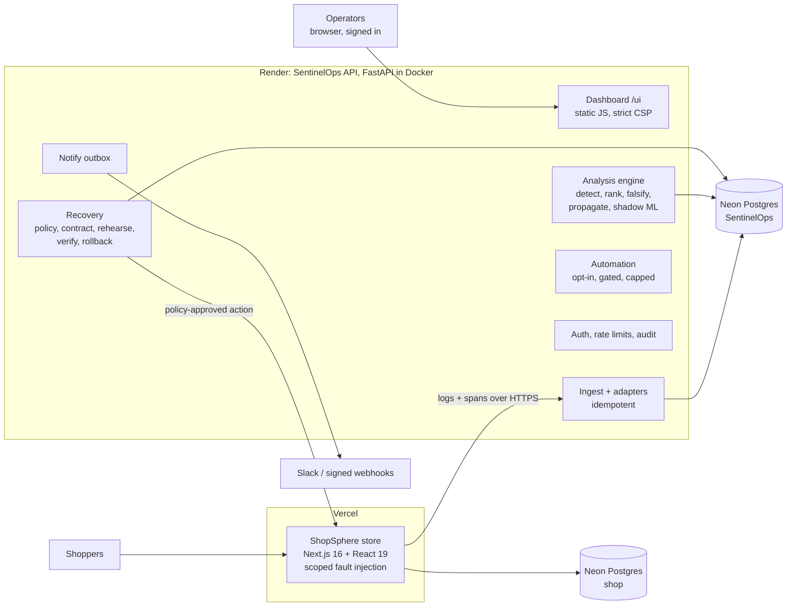
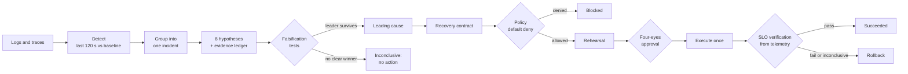

# SentinelOps AI

**Evidence-driven incident investigation and controlled recovery for cloud applications.**

SentinelOps watches a running application through its logs and traces. It detects when something
goes wrong and works out *why*, with the evidence for and against every possible cause. It then
fixes the problem through a recovery contract that a policy, a second person and post-fix telemetry
all have to agree with. It can also resolve incidents automatically, for causes you opt in.

> **Design principle:** never confuse a plausible explanation with a proven cause; never treat an
> executed action as a verified recovery.

| Live | URL |
| --- | --- |
| SentinelOps dashboard and API (Render) | https://sentinelops-ai-lukk.onrender.com/ui/ |
| ShopSphere, the monitored demo store (Vercel) | https://shopsphere-demo-beta.vercel.app |
| Full design document: every choice and the reasons | [docs/design-and-architecture.md](docs/design-and-architecture.md) |

## The problem

Most incident tooling stops at alerting and correlation: it shows *what* is red and blames the
latest deploy. The costly mistakes in operations are confident wrong actions, such as rolling back
a healthy release while the payment provider is the real problem, and false "resolved" claims. In
the benchmark, a naive alert correlator named the wrong cause in 42% of faults, proposed the wrong
fix just as often, and claimed recoveries that had not happened in 72% of cases. SentinelOps is
built to make both mistakes rare and visible.

## What is new here, and how it differs

AI-assisted root-cause analysis and guided remediation already exist (Elastic AI SRE, New Relic SRE
Agent, Dynatrace, Meta's DrP). SentinelOps does not claim those ideas are new. What it combines and
**measures** is a stricter discipline around them:

| SentinelOps | Typical AIOps / LLM assistant |
| --- | --- |
| **Evidence ledger**: every claim cites the stored events it came from, including **counter-evidence** and **missing** evidence | A summary or a correlation score; sources are often implicit |
| **Falsification**: read-only tests try to *disprove* the leading cause before anyone acts | Ranks by similarity or likelihood; rarely tests against the leader |
| **Abstains**: reports "inconclusive" when the evidence does not separate the causes | Usually names a cause regardless |
| **Recovery contracts**: preconditions, success SLIs, guardrails, a verification window and a rollback, checked by code | Runs a runbook step and closes the ticket |
| **Rehearsal**: replays recorded telemetry with the fix applied, before approval | No pre-check, or a full staging copy |
| **Outcome from telemetry only**: pass, fail or inconclusive is measured after the action; "it ran" is never "it worked" | Execution is treated as success |
| **Earliest containment point** from a propagation graph, scored against ground truth | Service maps without a containment answer |
| **Reproducible benchmark** with hidden ground truth, baselines and an ablation | Vendor claims |

## Architecture

A **modular monolith** (one FastAPI process with strict module boundaries) plus a separately deployed
demo shop. They share no code and no database; two narrow HTTPS interfaces connect them.



**From telemetry to verified recovery**



## Main features

| Area | What it does | Where |
| --- | --- | --- |
| Telemetry | JSON logs, text logs, OpenTelemetry-style spans and metrics through adapters; content-hash ids make ingest idempotent | `app/adapters.py` |
| Detection | Per route: 5xx rate and p95 latency over the last 120 s against a healthy baseline, with fixed, named thresholds; 429 throttling reported separately | `app/analysis/detect.py`, `throttle.py` |
| Root-cause engine | 8 causes ranked by a transparent, versioned score with an evidence ledger; abstains when unsure | `app/analysis/hypotheses.py` |
| Falsification | 8 read-only tests over stored logs and traces, chosen by information gain, that try to disprove the leader | `app/analysis/diagnostics.py` |
| Propagation | Failure-spread graph from traces and the earliest containment point | `app/analysis/propagation.py` |
| Telemetry quality | Detects a clock running ahead (events from the future) instead of diagnosing from it | `app/analysis/quality.py` |
| Recovery contracts | Default-deny policy, blast radius, rehearsal, four-eyes approval with a 30-minute expiry, execution at most once, SLO verification, rollback | `app/recovery/` |
| Automatic remediation | Opt-in per cause (`manual`, `propose`, `auto`): needs a confirmed cause, a passing rehearsal, risk within a ceiling and an hourly cap; auto-rollback | `app/automation.py` |
| Learned model | 25-feature root-cause classifier trained in a notebook; served in **shadow mode** (recorded, never obeyed), with per-feature explanations | [notebook](services/sentinel-api/notebooks/root_cause_model.ipynb), [model card](services/sentinel-api/models/MODEL_CARD.md) |
| Insights | Timeline, similar past incidents and what fixed them, postmortem drafts, SLOs with 14.4x burn-rate alerts, release markers | `app/insights.py` |
| Prevention compiler | After a verified fix: a regression test, an alert rule and a runbook edit, for human review only | `app/prevention.py` |
| Notifications | Slack and HMAC-signed webhooks through an outbox with retries; SSRF-safe URLs | `app/notify.py` |
| Security | Operator accounts and roles, scrypt passwords, signed sessions, sign-in lockout, rate limits, central audit log, strict headers | `app/auth.py`, `ratelimit.py`, `audit.py` |
| Dashboard | Overview, incidents with evidence, logs, trace waterfalls, charts, the model's explanation, SLOs, automation, notifications, audit, operators, and a link to the monitored store | `app/ui/` |
| Demo store | A real shop (catalogue, cart, checkout, accounts) whose faults change real behaviour: connection pool, cache, CPU, payment client, release, clock | [apps/shop-web](apps/shop-web) |
| Benchmark | 12 scenarios + 2 probes, hidden ground truth, alert-correlator and LLM (Claude or Gemini) baselines, ablations | `services/sentinel-api/benchmark/` |

## Tech stack, and why

| Layer | Choice | Why this, not the alternative |
| --- | --- | --- |
| API | Python 3.12, FastAPI, Pydantic | Typed request validation and settings; the analysis and ML code is Python too |
| Database | PostgreSQL on Neon, through SQLAlchemy 2 (SQLite in tests) | Transactions, compare-and-set state changes and unique constraints enforce the safety rules. A document store or Elasticsearch cannot guarantee them |
| Messaging | Outbox table in Postgres | At-least-once delivery that never announces a rolled-back change, with no broker to run |
| Dashboard | Plain JavaScript, no build step | Meets a strict CSP with no inline script, ships inside the API image, no npm supply chain on a tool that changes production |
| Observability | SentinelOps' own store and charts | Grafana, Prometheus and Loki store and display data, but hold no hypotheses, evidence or contracts. Raw requests are kept so every number can be cited as evidence |
| ML | scikit-learn in the notebook; a JSON logistic regression served in pure Python | No pickle loading or native libraries in the API; exact explanations |
| Demo store | Next.js 16, React 19 on Vercel | One framework for pages and API routes; free hosting and per-push deploys |
| Hosting | Render (Docker), Vercel, Neon | Each free tier fits one part; Render keeps the background loops alive |
| CI | GitHub Actions | Tests, lint, type checks, browser tests, benchmark smoke run, image build |

## Results

| Measure (simulated benchmark, 20 seeds) | Alert correlator | LLM only (Gemini 3.5 Flash-Lite) | SentinelOps |
| --- | --- | --- | --- |
| Correct cause named | 33% | 65% | **99%** (179/180) |
| Wrong recovery action proposed | 42% | 22% | **0%** (0/200) |
| Claimed a recovery that did not happen | 72% | 40% | **0%** |
| Recovery truly achieved and correctly claimed | 20% | 48% | **80%** |
| Fooled by a plausible but wrong leader (2 probes, 40 runs) | 50% | 100% | **0%** |
| Clock-skew telemetry flagged | 0% | 0% | **100%** |
| True origin named as the containment point | n/a | n/a | 98% |

The LLM reads the same log summary as the correlator, at temperature 0, and may only answer from the allowed causes.

On the real application, every scenario was diagnosed correctly after investigation, all 7
recoveries succeeded through the real executor, and a rollback restored the fault. On the **deployed**
system, 33 labelled incidents across all eight fault types: SentinelOps (rules + investigation) was
right on 31 with 1 wrong action, against 24 right and 6 wrong actions for the rules alone; the shadow
model was right on 33; the containment point was right 18 of 18 times; healthy and surge traffic
raised no false alarm, and the clock-skew run was flagged. The scenarios were written by the same author as the system, so these show
the mechanisms work, not that they generalize. Details and intervals:
[benchmark](docs/benchmark-results.md), [real incidents](docs/real-incidents.md).

## Run it

**Requirements:** Python 3.12, Node.js 22. Docker is optional (for the local stack), and so is a
Postgres URL (SQLite works locally).

```bash
# API tests (229) and the shop's checks
cd services/sentinel-api && pip install -r requirements.txt && python -m pytest -q
cd apps/shop-web && npm ci && npm run typecheck && npm run lint && npm test
cd apps/shop-web && npx playwright install chromium && npx playwright test          # shop journeys
cd apps/shop-web && npx playwright test -c playwright.dashboard.config.ts             # dashboard in a browser

# Everything locally with its own Postgres: http://localhost:8000/ui/  (admin / change-me-local-only)
docker compose up --build
```

**Without Docker** (PowerShell: `$env:NAME="value"`):

```bash
cd services/sentinel-api
SENTINEL_INGEST_TOKEN=<machine token> SENTINEL_SESSION_SECRET=<32+ random chars> \
SENTINEL_BOOTSTRAP_ADMIN=admin:<12+ char password> SENTINEL_SHOP_URL=http://localhost:3000 \
python -m uvicorn app.asgi:app --port 8000

cd apps/shop-web && npm run build
SHOP_DB=memory CHAOS_TOKEN=<16+ chars> ADMIN_TOKEN=<secret> SENTINEL_INGEST_URL=http://127.0.0.1:8000 \
SENTINEL_INGEST_TOKEN=<machine token> npx next start -p 3000
```

**Benchmark, campaign and end-to-end recovery**

```bash
cd services/sentinel-api
python -m benchmark --seeds 20 --out ../../docs/benchmark-results.md     # add GEMINI_API_KEY or ANTHROPIC_API_KEY for the LLM baseline
CHAOS_TOKEN=... SENTINEL_TOKEN=... SENTINEL_OPERATOR=campaign SENTINEL_OPERATOR_PASSWORD=... \
  python -m campaign.run_campaign --shop <shop> --sentinel <api> --scenarios S01 S02 S03 S04 S05 S06 S07 S08 none surge S11 --investigate
python -m campaign.evaluate --sentinel <api>
```

Deploying your own copy: [docs/deploy-api.md](docs/deploy-api.md).

## How to use it

1. **Sign in** to the dashboard. The first admin comes from `SENTINEL_BOOTSTRAP_ADMIN`. Create
   accounts under **Operators** with a role: `viewer`, `responder`, `approver` or `admin`.
2. **Overview** shows route health, open incidents, contracts waiting and any telemetry warnings. The
   **ShopSphere store** link in the sidebar opens the monitored application.
3. **Open an incident.** Read the leading cause, its score breakdown and the evidence. Every line
   opens the log events and traces it came from. Press **Investigate** to run the falsification tests.
4. **Propose** the recommended fix (responder). The contract shows its policy decision, blast radius
   and rehearsal result. **Approve** it as a different person (approver), then **Execute**.
5. **Verification** reports Succeeded, Failed or Inconclusive from post-fix telemetry. A failed fix can
   be **rolled back**.
6. **Label** the incident with its true cause, review the postmortem draft and the prevention
   proposals.
7. **Automate** trusted causes under **Automation** (admin), and add a Slack or webhook channel under
   **Notifications**.

## Repository layout

```
apps/shop-web/                 ShopSphere store (Next.js), fault injection, telemetry push, Playwright tests
services/sentinel-api/
  app/                         FastAPI application
    analysis/                  detection, hypotheses, diagnostics, propagation, quality, learned model
    recovery/                  policy, contracts, rehearsal, SLO verification, executors
    ui/                        dashboard (static HTML, JS, CSS)
    automation.py notify.py insights.py prevention.py auth.py audit.py ratelimit.py telemetry_api.py
  benchmark/                   simulated scenarios, baselines (alert correlator, LLM), metrics, report
  campaign/                    labelled campaign and end-to-end recovery runners for a live system
  training/  notebooks/  models/   ML data generator, training notebook, model card
  tests/                       229 tests
docs/                          design document, benchmark and real-incident reports, deployment, blueprint
render.yaml  docker-compose.yml  .github/workflows/ci.yml
```

## Limits

Single tenant; local accounts (no single sign-on yet). Rehearsal replays recorded telemetry instead
of a sandbox copy of production. The live executor is `mock`; there is no production executor, by
design. Schema changes need a migration tool (Alembic) before any column changes. The free Render
instance sleeps when idle, and telemetry pushed while it wakes is lost.

The original plan, with its roadmap and acceptance checklist: [docs/blueprint.md](docs/blueprint.md).
