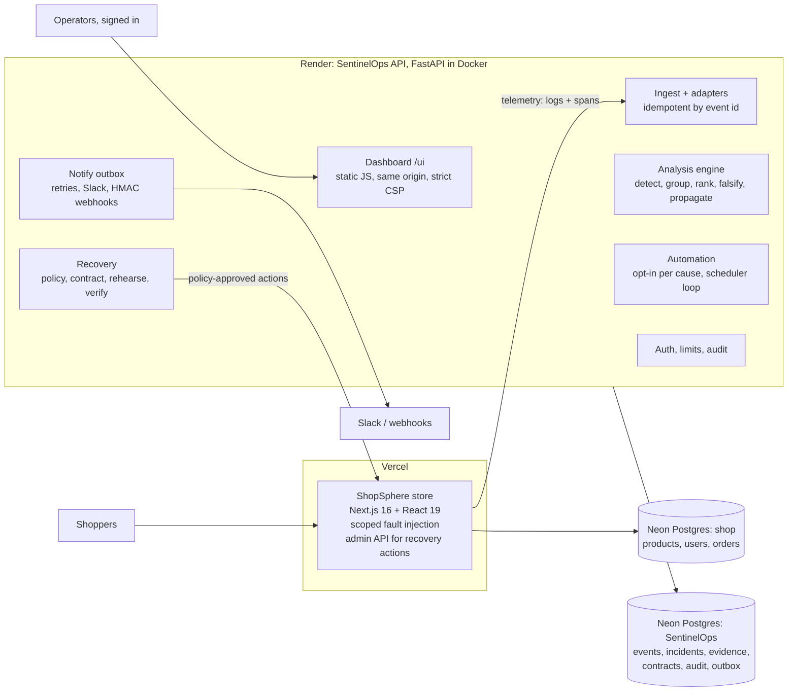
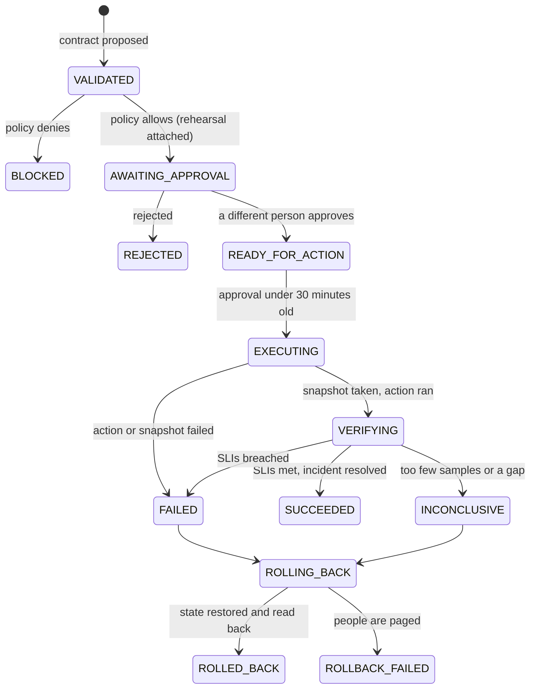

# SentinelOps AI: Design and Architecture

Written 29 October 2026. Also available as a shared document with drawn diagrams (export to PDF or Word from there).

## What SentinelOps is

SentinelOps AI investigates incidents in a cloud application and recovers from them under control. It reads the application's logs, traces and change events, decides whether something is wrong, ranks the possible causes with the evidence for and against each, and proposes a bounded fix that a policy, a second person and post-fix telemetry all have to agree with.

**Design principle:** never confuse a plausible explanation with a proven cause, and never treat an executed action as a verified recovery. Every design choice below follows from one of those two rules.

**Why this problem.** Most incident tooling stops at alerting and correlation: it says *what* is red and usually blames the latest deploy. In the benchmark that naive approach named the wrong cause 42% of the time and so proposed the wrong fix 42% of the time. The expensive mistakes in operations are confident wrong actions (rolling back a healthy release while the payment provider is the real problem) and false "resolved" claims. SentinelOps is built to make both rare and visible.

**Live system**

| Part | URL |
| --- | --- |
| SentinelOps API and dashboard (Render) | [sentinelops-ai-lukk.onrender.com/ui/](https://sentinelops-ai-lukk.onrender.com/ui/) |
| ShopSphere demo store (Vercel) | [shopsphere-demo-beta.vercel.app](https://shopsphere-demo-beta.vercel.app) |
| Source code | [github.com/barath80/SentinelOps-AI](https://github.com/barath80/SentinelOps-AI) |

**Features at a glance**

| Area | What it does |
| --- | --- |
| Telemetry ingestion | Accepts JSON logs, text logs, OpenTelemetry-style spans and metrics through adapters; idempotent, so a retried push never double-counts |
| Detection and grouping | Compares the last 2 minutes with a healthy baseline per route; folds related anomalies into one incident |
| Root-cause engine | Ranks 8 candidate causes with a transparent score and an evidence ledger in which every claim cites the event it came from |
| Falsification | Runs read-only tests designed to *disprove* the leading cause; reports "inconclusive" instead of forcing a winner |
| Propagation graph | Reconstructs how the failure spread and names the earliest point where it can be contained |
| Recovery contracts | Each fix is a machine-readable contract: target, preconditions, guardrails, verification window, rollback |
| Rehearsal | Replays recorded telemetry with the fix applied before anyone approves it |
| Four-eyes approval | The person who proposes a fix can never approve it |
| SLO verification and rollback | Recovery is "pass" only when post-fix telemetry meets the SLO; a failed fix can be rolled back |
| Automatic remediation | Opt-in per cause, gated by falsification, rehearsal, risk and an hourly cap |
| Learned model (shadow) | A logistic-regression root-cause model that runs beside the rules and is recorded, never obeyed |
| Insights | Timeline, similar past incidents and what fixed them, postmortem drafts, SLO error-budget burn |
| Prevention compiler | Proposes regression tests, alert rules and runbook edits for human review |
| Team notifications | Slack and signed webhooks through an outbox with retries |
| Security | Operator accounts and roles, rate limits, audit log, SSRF-safe webhooks, strict browser headers |
| Dashboard | Incidents, evidence, logs, traces, charts, approvals, automation, notifications, audit, with a link to the shop |

## What is new, and how it differs

AI-assisted root-cause analysis and guided remediation already exist in products such as Elastic AI SRE, New Relic SRE Agent, Dynatrace and Meta's DrP. SentinelOps does not claim those ideas are new. Its contribution is a stricter discipline around them, and measurements of what that discipline buys.

| SentinelOps | Typical AIOps or LLM assistant | Why it matters |
| --- | --- | --- |
| Evidence ledger: every claim cites stored events, including counter-evidence and missing evidence | A summary or a correlation score | An approver can check a claim in one click instead of trusting it |
| Falsification: tests try to disprove the leader before anyone acts | Ranks by similarity or likelihood | Falsification took wrong actions from 20% to 0.5% in the benchmark |
| Abstains with "inconclusive" | Usually names a cause regardless | No cause means no automatic action, the safe failure |
| Recovery contracts checked by code | Runs a runbook step | Preconditions, guardrails and rollback are explicit and audited |
| Rehearsal on recorded telemetry | No pre-check, or a full staging copy | Catches a fix that cannot work, at no infrastructure cost |
| Outcome measured after the action | Execution treated as success | The baseline claimed 72% of recoveries that never happened; SentinelOps 0% |
| Earliest containment point, scored against ground truth | Service maps | Says where a timeout or circuit breaker would have stopped the spread |
| Learned model in shadow mode | Model decides directly | Real-world evidence is collected before a model is trusted with production |
| Reproducible benchmark with hidden ground truth and baselines | Vendor claims | Every number above can be regenerated with one command |

The comparison is based on public product descriptions, not a patent search or a market survey.

## Architecture

SentinelOps is a **modular monolith**: one FastAPI process holds every control-plane module, and the demo shop is a separate application that it watches. They share no code and no database; the only links between them are two narrow HTTPS interfaces.



The shop pushes logs and spans to `POST /api/v1/telemetry/events` with a machine token. SentinelOps changes the shop only through the shop's admin API, and only after the policy engine allows the action. Highlighted: the two modules that make the decisions.

**How a request moves through it.** Telemetry lands in the `events` table through an adapter. The analysis engine reads a time window of events, raises or refreshes incidents and writes hypotheses and evidence. People (or opt-in automation) open a recovery contract, which passes policy, rehearsal and approval before the executor runs it. A verifier then measures post-action telemetry. Every step that matters writes an outbox row, so the notify sender tells the team.

**Why a modular monolith, not microservices.**

- **One transaction per decision.** Approving a contract, writing its audit row and queuing its notification happen in one database transaction. Split across services, that needs distributed transactions or sagas, and a half-applied approval is exactly the failure this tool exists to prevent.
- **Strict module boundaries anyway.** `analysis/` never imports `recovery/`; recovery reads hypotheses only through the database. Each module registers its own routes. A module can be split out later along a boundary that already exists.
- **Fits the hosting.** A free Render instance runs one container. Six services would mean six cold starts and six deploy pipelines for a team of one.

**Why the shop is separate.** It is the system under test. Keeping it apart means SentinelOps sees it only the way it would see any real application, through pushed telemetry, and cannot cheat by reading the shop's internal state or the fault switch. The fault headers (the ground truth) are never logged.

**Alternatives considered**

| Option | Why not |
| --- | --- |
| Microservices (ingest, analysis, recovery, notify) | Distributed transactions for approvals; more failure modes than the system it watches |
| Prometheus + Loki + Tempo + Alertmanager stack | Good at storing and alerting, but has no hypotheses, evidence or contracts; would still need this whole control plane on top, plus three more services to host |
| Serverless functions for the API | No long-lived background loop for the notification sender, verification and automation; cold starts on every call |
| Message queue (Redis, Kafka) between modules | The outbox table gives the same at-least-once delivery inside the existing database, with no extra service to run |

The original blueprint listed Redis, Prometheus and Loki. They were left out on purpose: at this scale Postgres does each of those jobs, and every extra component is one more thing that can fail during an incident.

## Networking and cloud-native practices

All traffic between the parts is HTTPS over the public internet, and each part trusts the others as little as possible.

| Connection | Protocol and port | Authentication | Notes |
| --- | --- | --- | --- |
| Browser to dashboard and API | HTTPS 443, Render's TLS | Operator session token (`Authorization: Bearer`) | Same origin, so no CORS is opened at all |
| Shop to SentinelOps ingest | HTTPS 443 | Machine token | 3-second timeout, so a sleeping API never slows the shop |
| SentinelOps to the shop's admin API (executor) | HTTPS 443 | Admin token | Only after policy and approval; `mock` on the live system |
| Both apps to Neon Postgres | Postgres protocol over TLS (`sslmode=require`) | Database role and password | Neon's connection pooler absorbs serverless connection bursts |
| SentinelOps to Slack and webhooks | HTTPS 443, outbound only | URL secret; HMAC signature on generic webhooks | Public addresses only, re-checked before each send; redirects not followed |
| Render's proxy to the container | HTTP on `$PORT` inside Render's network | none (private hop) | The client address is read from the last trusted `X-Forwarded-For` entry |

**Cloud-native practices followed**

- **Configuration in the environment**: every setting is a `SENTINEL_` variable validated at startup, and no secret is in the repository.
- **Stateless processes**: sessions are signed tokens, all state is in Postgres, and the container can be replaced at any time.
- **Disposable, immutable images**: CI builds the image; a slim base image runs as a non-root user with only runtime dependencies.
- **Health check**: `GET /health` lets Render restart a broken instance.
- **Logs as event streams**: the shop writes JSON lines to stdout and pushes the same records.
- **Backing services as attached resources**: Postgres, Slack and the shop are reached only by URL, so any of them can be swapped by configuration.

Kubernetes, a service mesh and a message broker were not used: one container per app gets nothing from orchestration, and each would add a component that can fail during an incident.

## Telemetry: logs, traces, metrics and changes

SentinelOps diagnoses from four kinds of signal, because each one answers a question the others cannot. Every record, from any source, is converted into one `NormalizedEvent` shape before it is stored.

| Signal | What it answers | Example from the shop |
| --- | --- | --- |
| Request logs | *What* is failing: route, status, latency, release version | `{"route":"/api/checkout","status":504,"duration_ms":3004,"version":"v2"}` |
| Error and domain logs | *What the code saw*: `payment_timeout`, `payment_retry`, `unhandled_exception` | the same request id as the failing request line |
| Traces (spans) | *Where the time went*: pool wait, query, payment call, cache, CPU time per request | a root span with child spans `db.pool.acquire`, `db.query`, `payment.charge` |
| Change events and release labels | *What changed*, and when, so a deploy can be blamed or cleared | `version` on every log line; release markers on the charts |

**Why traces matter so much.** Four causes look identical in logs: a slow query, an exhausted connection pool, a dead cache and a saturated CPU all just show "checkout is slow". Only the span breakdown separates them (time waiting for a pool connection, time in the query, a cache span that errors, `cpu_ms` on the root span). The first learned model used logs only and could not tell those causes apart; version 2 added trace features and fixed it.

**How it is collected.** The shop writes structured JSON logs to stdout and buffers them with its finished spans (up to 200 records), then pushes them to SentinelOps over HTTPS with the machine token. It pushes from inside the app because Vercel's free plan has no log drains, and a push works on any host. Spans use OpenTelemetry's field names and shape (`traceId`, `spanId`, `parentSpanId`, `startTimeUnixNano`, status codes 0/1/2). Code wraps work in `withSpan()`, and Node's `AsyncLocalStorage` carries the parent span, so no id is passed around by hand.

**Adapters.** Ingest takes an `adapter` parameter, and each adapter is one function that maps a raw record to `NormalizedEvent`:

- `shop_json`: the shop's structured logs
- `otel_span`: OpenTelemetry-style spans
- `metric`: a metric point with name, value and labels
- `text`: plain text log lines, with a message template extracted
- `normalized`: records already in the common shape

Adapters never invent data: anything they cannot map is kept unchanged in `attributes`. Adding a new source means adding one function.

**Idempotent ingest.** An event's id is a UUID derived from a SHA-256 hash of its canonical JSON, and inserts use `ON CONFLICT DO NOTHING`. A retried push, a duplicate delivery or a replay therefore never double-counts a failure. The response says how many records were accepted, duplicates or rejected, with the first 20 errors.

**Telemetry you cannot trust is reported, not used.** An event cannot legitimately be timestamped after it arrived. When events arrive "from the future" (scenario S11, the shop's clock running 4 minutes ahead), the quality check flags it and the dashboard shows a clock-skew warning, so nobody diagnoses from a distorted timeline. Events up to 5 minutes ahead are kept, so the problem stays visible rather than hidden. Old timestamps are not flagged, because they look exactly like legitimate backfill.

**Why these choices, not others**

| Choice | Alternative | Reason |
| --- | --- | --- |
| OpenTelemetry span shape | A custom trace format | Any OTel-instrumented service can send spans with no new code; the industry standard |
| Push from the app | Log drains or a collector agent | Works on Vercel's free plan and on any host; one code path in development and production |
| One normalized event table | A separate store per signal (metrics DB, log store, trace store) | One query joins a failing request's log line, its spans and its error logs by `request_id` and `trace_id`; evidence can cite any of them by one id |
| Request logs as the primary metric source | Pre-aggregated counters | Raw requests keep the evidence: every "error rate 80%" can be opened as the exact requests behind it |
| Content-hash event ids | Database-assigned ids | Duplicates are detected without any coordination between sender and receiver |

## Observability tooling: why not Grafana, Prometheus and Loki

**Grafana is not used.** The original blueprint listed Grafana, Prometheus and Loki as the observability stack. They were left out on purpose, and the reasons are specific:

| Tool | What it is good at | Why SentinelOps does not depend on it |
| --- | --- | --- |
| Grafana | Dashboards over many data sources | SentinelOps' screens are not just charts. They hold hypotheses, evidence, contracts and approvals, and each chart point opens the requests behind it. A Grafana panel shows a number; it cannot cite the request that produced it |
| Prometheus | Cheap, aggregated numeric time series and alerting | Aggregation throws away the individual requests. SentinelOps needs those requests as evidence ("error rate 80%" must open the exact 504s), and its own detector replaces Prometheus alert rules |
| Loki | Cheap log storage, label-indexed | Joining a log line to its spans and to the incident's evidence needs relational joins, which one Postgres table gives directly |
| OpenTelemetry Collector | Routing telemetry between many services | One shop pushing directly needs no collector; the span format is OTel-compatible, so a collector can be added without code changes |

The deciding argument is operational: each of these is a service to host and keep healthy. Running four extra services to watch one shop would make the monitoring stack larger and more fragile than the system it watches. On free hosting it would not fit at all.

**How SentinelOps fits next to them.** In an organisation that already runs Grafana or Prometheus, SentinelOps is a layer on top, not a replacement. The `metric` adapter accepts metric points, so Prometheus data can be forwarded in. The OTel span adapter accepts traces from any instrumented service. Notifications and webhooks can feed an existing alerting or paging tool. A Grafana panel could also chart SentinelOps' own Postgres tables, such as incidents per day or recovery outcomes, with no changes to SentinelOps.

**What watches SentinelOps itself.** Render's health check restarts a failed instance. The overview shows events ingested in the last 15 minutes, so a silent telemetry stop is visible. Failed notifications in the last 24 hours are counted on the overview, and every important change is in the audit log.

## Storage: why SQL, why PostgreSQL

Everything SentinelOps knows lives in one PostgreSQL database (hosted on Neon), accessed through SQLAlchemy 2 and the psycopg 3 driver. The tests run the same code on SQLite files, so the full suite needs no database server.

**Why a relational database.** The core of SentinelOps is not the telemetry; it is the *decisions* about it: incidents, hypotheses, evidence, contracts, approvals, actions, verifications and rollbacks. Those records are linked (evidence belongs to a hypothesis, which belongs to an incident; an approval belongs to a contract) and must never disagree. That is the problem relational databases solve:

- **Transactions.** Approving a contract updates its state, appends an audit row and queues a notification in one transaction. Either all three happen or none do.
- **Compare-and-set state changes.** Every contract transition is `UPDATE ... WHERE id = ? AND state = <expected>`. If two people (or a person and the automation loop) act at once, exactly one wins and the other gets a clear conflict, never a double execution.
- **Constraints as safety rules.** A unique index on `action_runs.contract_id` makes "an action runs at most once per contract" a database guarantee, not just application logic. Foreign keys with `ON DELETE CASCADE` keep evidence from pointing at deleted incidents.
- **Joins for evidence.** A ledger entry cites event ids; opening it is a primary-key lookup. Following a failing request to its spans is a join on `trace_id`.

**Why PostgreSQL specifically**

| Need | What Postgres gives |
| --- | --- |
| Flexible event attributes | `JSON` columns: each source keeps its own fields without a schema change per source |
| Idempotent ingest | `INSERT ... ON CONFLICT DO NOTHING RETURNING`, so duplicate counts come back in one round trip |
| Correct time | `timestamptz` columns; a `UTCDateTime` type makes every timestamp timezone-aware UTC, in Postgres and SQLite alike |
| Serverless hosting | Neon gives a free, managed Postgres with connection pooling that both Vercel and Render reach over TLS |
| One engine for everything | The outbox, audit log, automation runs and telemetry all sit in the same transactional store |

**The tables**

| Group | Tables |
| --- | --- |
| Telemetry | `events` (primary key: tenant + content-hash event id) |
| Diagnosis | `incidents`, `hypotheses`, `evidence`, `diagnostic_runs` (unique per incident and test), `incident_labels` |
| Recovery | `recovery_contracts`, `contract_transitions` (append-only), `approvals`, `action_runs`, `verification_runs`, `rehearsal_runs`, `rollback_runs` |
| Operations | `operators`, `audit_log`, `notification_channels`, `notifications` (the outbox), `automation_policies`, `automation_runs`, `prevention_artifacts` |

**The outbox pattern.** A notification is a row written in the same transaction as the change it reports. A background sender claims due rows with a 60-second lease (compare-and-set again), posts them outside any transaction, and records the result. Failures retry with exponential backoff (30 s, 60 s, 120 s ...) up to 5 attempts. This gives at-least-once delivery that can never announce a change that rolled back, with no message broker to run.

**Retention keeps the evidence.** Events older than 7 days are purged, except any event that an incident's evidence or a diagnostic run cites. Every claim in the ledger therefore keeps resolving to its source, however old.

**Alternatives considered**

| Option | Why not |
| --- | --- |
| MongoDB or another document store | Weak multi-document transactions and no foreign keys; the approval and audit invariants would move into application code |
| Elasticsearch or OpenSearch | Excellent log search, but not a system of record: no transactions, eventual consistency, heavy to host |
| A time-series database (TimescaleDB, InfluxDB, Prometheus) | Built for aggregated numeric series; SentinelOps needs the raw request records to cite as evidence, plus relational decision records. TimescaleDB is a Postgres extension, so it stays an option if event volume grows |
| SQLite in production | Single-writer and local-file only; does not survive Render's ephemeral disk |
| Raw SQL instead of an ORM | SQLAlchemy keeps one code path for Postgres and SQLite, and its Core expressions still allow exact statements (`ON CONFLICT`, compare-and-set) where they matter |

**Known limit.** Startup creates missing tables but never alters existing ones. The next schema change to an existing column needs a real migration tool (Alembic).

## Detection and the root-cause engine

The engine works in five steps: detect what is abnormal, group it into an incident, propose every plausible cause with evidence for and against, try to *disprove* the leader, and say "inconclusive" when the evidence does not separate the candidates.

**1. Detection.** For each route, the last 120 seconds are compared with a healthy baseline. A route is anomalous only when the change is both large and real:

| Kind | Rule (all thresholds are named parameters in `DetectionConfig`) |
| --- | --- |
| Errors | recent 5xx rate above 10% **and** at least 10 points above the baseline rate |
| Latency | recent p95 at least 2x the baseline p95 **and** at least 200 ms slower |
| Sample size | at least 5 recent and 20 baseline requests, so a quiet minute is never an incident |
| Throttling | a burst of 429 responses, reported separately (a 429 is a client error, so the 5xx rule ignores it) |

Detection is deterministic on purpose: medians, MAD and percentiles with fixed thresholds, no learned model. The same telemetry always gives the same incidents, which makes every result reproducible and every threshold arguable.

**2. Grouping.** Anomalies that start within 120 seconds of each other become one incident, and a new anomaly near an open incident refreshes it instead of opening a duplicate. One outage gives one page, not five.

**3. Hypotheses and the evidence ledger.** Rules propose eight candidate causes: `release_regression`, `payment_provider_timeout`, `slow_dependency`, `db_pool_exhaustion`, `cache_unavailable`, `resource_saturation`, `retry_storm` and `traffic_surge`. Each rule attaches evidence items that **support**, **contradict** or are **missing**. Each item has a strength between 0 and 1, a plain-language explanation built from the measured numbers, and the ids of the stored events it came from. Nothing in the ledger is free text without a source.

The ranking is a transparent, versioned score (`score-v1`), deliberately *not* called a probability:

```math
\text{score} = 1.0\,S + 0.5\,T + 0.3\,D - 1.2\,C - 0.5\,M
```

Here S is supporting strength (capped at 2), C is contradicting strength (capped at 2) and M is missing evidence (capped at 1). T and D are the timing and dependency fit, counted only when something supports the hypothesis. Contradictions weigh more than support (1.2 against 1.0) because one solid counter-observation should beat several weak agreements. A cause becomes the **leading hypothesis** only with a score of at least 1.0 and a lead of at least 0.5 over the runner-up. Otherwise the incident is **inconclusive** and no action is recommended.

**4. Falsification.** The investigation loop runs read-only tests chosen to *disprove* the current leader, picking the test with the best expected information for its cost, within a budget of 4 tests:

| Test | Hypothesis it can falsify |
| --- | --- |
| `compare_error_rate_before_after_release` | release regression: was the old release healthy on the same route? |
| `inspect_payment_provider_status_and_spans` | payment provider timeout |
| `inspect_db_pool_wait_and_query_duration` | slow dependency: is the time inside the database spans? |
| `inspect_db_pool_acquire_wait` | connection-pool exhaustion: is the time spent waiting for a connection? |
| `inspect_cache_spans` | cache unavailable |
| `inspect_cpu_time` | resource saturation: does `cpu_ms` track the latency? |
| `inspect_retry_amplification` | retry storm: are payment calls multiplied per request? |
| `compare_request_rate_to_baseline` | traffic surge |

Each test is an allow-listed function over events already stored: no shell, no arbitrary query, no network. A direct contradiction of strength 0.8 or more marks the hypothesis **falsified**; it can never lead again for that incident. Earlier scores are kept in `score_history`, so the dashboard shows how the ranking changed and why.

**5. Per-symptom attribution and propagation.** Each symptom is also ranked on its own, so an incident with two unrelated faults reports `multi_cause` or `partial` instead of forcing one winner. From traces, a propagation graph orders the anomalous dependencies (pool, database, payment provider, cache, compute) by onset. Edges are labelled `observed`, `not_reached` or inferred. The earliest anomalous dependency is the **earliest containment point**: where a timeout, circuit breaker or failover would have stopped the spread.

**Why rules plus falsification, and not an LLM or a pure ML model**

| Approach | Strength | Why it is not the decision-maker here |
| --- | --- | --- |
| LLM reads the telemetry | Broad knowledge, good summaries | Can state a cause with confidence and no evidence; invents plausible ids and numbers; answers vary run to run; no audit trail of *why* |
| Pure ML classifier | Learns patterns from many incidents | Needs large labelled incident sets that real teams do not have; a misclassification is hard to explain to the person approving an action |
| Alert correlation ("blame the latest change") | Simple and fast | Named the wrong cause in 42% of benchmark faults |
| **Rules + evidence ledger + falsification** | Every claim cites its data; deterministic; abstains when unsure | Rules must be written per cause. Accepted, because each cause also needs its own recovery action and its own test anyway |

The learned model and the LLM baseline are both kept, as an observer and a benchmark comparison, so the choice stays measured rather than assumed.

## Recovery: contracts, rehearsal, approval, verification, rollback

A recovery action never runs as a bare command. It runs as a **recovery contract**: a machine-readable record of what will be done, what must be true first, what success means, how long to watch, and how to undo it. A guarded state machine moves the contract, and code (not a person's say-so, and not the action finishing) decides each step.



Every arrow is an atomic compare-and-set that appends an immutable `contract_transitions` row with the actor, the policy version and a note. A failed action (or a failed pre-action snapshot) goes straight to Failed, without any recovery being claimed.

**What a contract holds**

| Field | Example (payment timeout) |
| --- | --- |
| Action template | `restore_payment_simulator`: set the payment simulator back to healthy mode |
| Target and environment | `payment-simulator` in `demo` |
| Preconditions | the incident is still open and the policy still allows the action |
| Success predicates (SLIs) | checkout error rate at most 1%; checkout p95 at most the larger of 500 ms and 1.5x its pre-incident p95 |
| Guardrails | every route the incident did not affect must stay at or below a 1% error rate |
| Verification window | 60 seconds of post-action traffic; a telemetry gap over half the window makes it inconclusive |
| Rollback | `revert_restore_payment_simulator`, restoring the snapshot taken just before the action |
| Rehearsal result | pass, fail or inconclusive, with the replayed numbers |

**The policy engine (default deny).** The engine, a person or an LLM can only *name* an action from the catalogue. Whether it may run is decided by code. An unknown action is refused. So is one outside its allowed environments (every action is limited to `sandbox` and `demo`), or a disruptive action with critical dependents. `restart_shared_database` is in the catalogue on purpose and is never allowed, to show the block working (scenario S12). Each action also declares a risk level (`low`, `medium` or `high`) and its blast radius, worked out from dependency-graph reachability.

**Rehearsal.** Before anyone approves, the incident's recorded telemetry is replayed with the action's modelled effect. The question is: "if this action did what it is meant to do, would the success conditions have held over the incident window?" Each action has a deliberately narrow effect model. When the data cannot show the effect, for example when no request still runs the previous release, the answer is `inconclusive`, never an optimistic guess. A **failing** rehearsal is the valuable case: it shows the action cannot fix what the telemetry shows. The approver must then acknowledge it explicitly. In the benchmark, rehearsal alone halved wrong actions (20% to 10%).

**Four eyes.** The proposer can never approve their own contract, and an approval expires after 30 minutes, because conditions change during an incident. The machine token can ingest and analyse but can never label, propose, approve or execute.

**Execution.** The executor first captures the target's current configuration, then runs the action, at most once per contract (a unique index enforces it). The executor reports only whether the *action* ran. It says nothing about recovery. On the live system the executor is `mock`, which records the call. The `shop_admin` executor really switches the demo shop's fault state, and was used for the end-to-end recovery runs.

**Verification decides the outcome.** When the window closes, the verifier measures the success predicates on post-action telemetry only. Pass means Succeeded and the incident is resolved. A breach means Failed. Too few samples or a telemetry gap means Inconclusive, never "pass by default". Whether the action ran is not an input at all. This is the second half of the design principle: an executed action is not a verified recovery.

**Rollback.** A Failed or Inconclusive contract can be rolled back, once. The rollback restores the pre-action snapshot, then reads the configuration back to confirm it. If the rollback itself fails, the contract ends in Rollback failed and a `rollback.failed` notification asks for a person.

**Why a contract state machine, and not runbook scripts or direct API calls**

| Alternative | Problem it has | How the contract avoids it |
| --- | --- | --- |
| Runbook scripts run by hand | No record of why, who approved, or whether it worked | Every transition is an audit row with the actor and the reason |
| "Run it and close the ticket" | Treats execution as success | The outcome comes only from measured SLIs |
| Direct automation calls from alerts | Two alerts can fire the same fix twice; nothing stops a dangerous action | Compare-and-set states, a unique action run, default-deny policy |
| Approval in chat | Self-approval and stale approvals are easy | Four eyes and the 30-minute expiry are enforced in code |

## Automatic remediation: how it resolves incidents on its own

SentinelOps can fix an incident without a person, but only for causes an admin has explicitly opted in, and only through the same recovery contract a person would use. Automation is a second *driver* of the state machine, not a shortcut around it.

**Three modes per cause.** Any cause with no policy is `manual`.

| Mode | What SentinelOps does |
| --- | --- |
| `manual` (default) | Diagnoses and notifies; people propose, approve and execute |
| `propose` | Opens the recommended contract itself; a person still approves it |
| `auto` | Proposes, approves on the policy's authority, executes, and rolls back automatically if verification fails |

**One automatic pass, step by step.** The pass runs every scheduler tick, or on demand from the dashboard. Each step re-checks its own preconditions, so running it often is safe.

1. **Close due verifications.** Every contract whose window has ended is verified from telemetry. This read-only step runs for all contracts, including those people executed.
2. **Roll back its own failures.** A contract that automation executed, that failed, and whose cause has `auto_rollback` on, is rolled back to its pre-action snapshot.
3. **Act on open incidents** whose assessment is `leading_hypothesis`. For each one it checks, in order:
   1. the global switch is on, and the deployment allows automation (`SENTINEL_AUTOMATION_ALLOWED`)
   2. the leading cause has a policy of `propose` or `auto`
   3. automation has not already acted on this incident (at most once per incident; people take it from there)
   4. the cause has a recommended action in the catalogue
   5. the leader **survived falsification**: a diagnostic test supported it with strength of at least 0.8
   6. fewer than the hourly cap of actions ran in the last hour (default 3)
   7. the policy engine allows the action
4. **In `auto` mode, three more gates** come before execution: the rehearsal must **pass** (inconclusive or failed means a person decides), and the action's declared risk must be within the policy's `max_risk` (`low` by default). The approval is recorded as `policy:<cause>`, with a note naming the admin who set the policy and when.
5. **Execute, then verify.** The executor runs the action; the next pass closes the verification window and measures the outcome, exactly as for a person.

Every step, including every skip and its reason, is written to `automation_runs` and announced on the `automation.action` channel. A skip that repeats unchanged on every pass is stored once, so real actions are not buried in the history.

**Example.** The payment provider starts timing out. Detection opens an incident; the engine leads with `payment_provider_timeout`; the investigation's span test confirms it. Payment timeouts are in `auto` mode, and `restore_payment_simulator` is low risk. The rehearsal shows that with a healthy provider the checkout error rate would have stayed under 1%. Automation therefore opens the contract, approves it as `policy:payment_provider_timeout` and executes it. Sixty seconds later the verifier measures checkout back under 1% errors and resolves the incident. The team sees each step in Slack.

**Why opt-in, gated and capped, and not "always auto-fix"**

- **Confidence must be earned per incident.** Auto mode requires a *confirmed* cause, not just a leading score. A cause that only looks likely is exactly where automatic fixes do damage.
- **A failed rehearsal is a veto.** If replaying the data says the fix cannot work, a person decides.
- **Blast radius stays bounded.** The risk ceiling, the hourly cap and "once per incident" stop a runaway loop: two alerts cannot trigger two rollbacks.
- **A kill switch beats tuning.** The global switch turns every cause off at once, and the deployment ceiling (`SENTINEL_AUTOMATION_ALLOWED=false`) makes automation impossible to switch on at all.
- **Same audit trail as people.** Automatic actions are never second-class: they appear in the contract history, the audit log and the notifications.

## The learned model, insights and prevention

**The learned root-cause model runs in shadow mode.** Its prediction is recorded next to the rule engine's answer and shown on the incident page with an explanation. It never changes a ranking, a recommendation or an action.

| Aspect | Detail |
| --- | --- |
| Features | 25 per incident, computed from telemetry alone: 17 from request logs, 8 from traces (`pool_wait_share`, `query_share`, `cache_fail_share`, `cpu_share`, `payment_calls_per_request`, `payment_hang_share`, `retry_log_share`, `trace_coverage`) |
| Research model | Random forest, chosen by cross-validated macro-F1; probabilities calibrated; trained on 12,711 simulated incidents |
| Abstention | Names a cause only when its calibrated probability is at least 0.87 (chosen for 99% precision on validation); otherwise `unknown` |
| Served model | A compact logistic regression stored as JSON, run in pure Python (standardize, linear scores, softmax): no scikit-learn or pickle in the API |
| Explanation | Per-feature contributions to the top class's score (coefficient times the standardized feature) |
| Same features in training and serving | Training and the API call the same feature functions, so the model is served exactly what it learned from |

*Why shadow mode, and why logistic regression for serving.* The model was trained on simulated incidents written by the same author as the system. Until it has been measured on enough real incidents, letting it act would put an unvalidated model in charge of production changes. Shadow mode collects that evidence for free: each labelled incident shows whether rules or model were right. On 25 real labelled incidents from the deployed system, the rules (before investigation) were right 19 times and the model 25 times: encouraging, but still too few to promote it. The served model is logistic regression because it is small, needs no native libraries, and its explanation is exact rather than approximated. A pickle file would also execute code when loaded; a JSON of coefficients cannot.

**Insights** (all read-only and computed from stored records)

| Insight | How it works |
| --- | --- |
| Timeline | Merges the incident's onset, detection, diagnostic runs, contract transitions and notifications into one ordered list |
| Similar past incidents | Cosine similarity between this incident's standardized feature vector and every earlier one, with what each turned out to be and which fix worked |
| Postmortem draft | A Markdown draft in which every statement links back to the evidence or event it came from; never published by SentinelOps |
| SLOs and error budgets | Per route: 99% availability target and 500 ms p95 target over 24 hours, with the error budget remaining |
| Burn-rate alerts | A route burning its budget 14.4x faster than allowed (2% of a 30-day budget in one hour, the Google SRE workbook threshold) raises `slo.burn` |
| Release markers | Each new version seen in the telemetry is drawn on the charts, so a deploy that coincides with a problem is visible, and so is one that does not |

**The incident-to-prevention compiler.** Once a cause is confirmed (its fix passed SLO verification and the incident is resolved), SentinelOps proposes artifacts that would have caught or prevented it: a regression test, an alert rule, a runbook amendment, and a follow-up for each piece of evidence that was missing. Generation is deterministic templating, not an LLM. Every artifact links to the incident, the verified contract and the evidence behind it, passes static checks, and starts as `proposed`. Only an approver can accept or reject it. Nothing is merged, deployed or run by the system.

*Why only after verification.* A prevention artifact written for an unconfirmed cause would encode a guess as a permanent alert or test. Waiting for a verified fix means each one is built on a cause that was demonstrated, not just suspected.

## Machine learning in depth: how the model was built

The model is trained in a reproducible notebook, [root\_cause\_model.ipynb](https://github.com/barath80/SentinelOps-AI/blob/main/services/sentinel-api/notebooks/root_cause_model.ipynb), built from `notebooks/build_notebook.py` and documented in a model card. The pipeline has six steps.

1. **Generate labelled incidents.** A parametric simulator (`training/generator.py`) produces shop telemetry for 10 classes: the 8 causes, `unknown` (a real fault with no distinguishing signal) and `no_fault` (a false alarm). It randomises traffic volume, noise, cold starts, outliers, missing logs, partial faults, **decoy deployments** and partial or absent tracing, so the classes overlap the way real incidents do.
2. **Extract features with the production code.** The same detector and feature functions the API uses (`app/analysis/ml_features.py`) turn each incident into 25 numbers: 17 from logs, such as error delta, p95 ratio, timeout share and exception ratio, and 8 from traces. Labels never enter the features, and a test checks that.
3. **Train and tune.** Three algorithms are compared with stratified 5-fold cross-validation on macro-F1.
4. **Calibrate and choose an abstention threshold** on a separate validation split.
5. **Test on two held-out sets:** A uses the same settings with unseen seeds; B is shifted (sparser, noisier, more decoys and missing logs) to measure robustness.
6. **Compare, explain and export:** the model against the rule engine on identical inputs, error analysis, and an export of the serving model.

| Data split | Seeds | Detected incidents |
| --- | --- | --- |
| Train | 0 to 1,500 | 12,711 |
| Test A, in-distribution | 100,000 to 100,400 | 3,405 |
| Test B, shifted | 200,000 to 200,400 | 3,074 |

| Algorithm | Cross-validated macro-F1 |
| --- | --- |
| Random forest (chosen) | 0.939 ± 0.009 |
| Gradient boosting | 0.938 ± 0.005 |
| Logistic regression | 0.895 ± 0.008 |

Probabilities are calibrated with a sigmoid fit. The model names a cause only when its calibrated probability is at least 0.87, the threshold that gave 99% precision on validation. **The metric that matters is incorrect intervention**, a wrong actionable cause, because that triggers the wrong fix:

| Test set | System | Exact accuracy | Incorrect intervention | Missed fixable cause |
| --- | --- | --- | --- | --- |
| A, in-distribution | Learned model | 91.4% | 0.6% | 7.2% |
| A, in-distribution | Rule engine, no falsification | 47.0% | 21.3% | 27.5% |
| B, shifted | Learned model | 71.2% | 1.1% | 23.8% |
| B, shifted | Rule engine, no falsification | 35.6% | 26.4% | 28.7% |

Under the shift the model's accuracy falls, but it fails safely: it abstains more often (missed causes rise) while wrong interventions stay near 1%.

**Served model versus research model.** The random forest's saved file is 168 MB. That is too large for the API image and for git, and loading it would mean unpickling, which can execute code. The API therefore serves a **logistic regression** exported as a 9 KB JSON of means, scales, coefficients and intercepts. It runs in pure Python, with its own abstention threshold of 0.82. Its explanation is exact: each feature's contribution is its coefficient times its standardized value.

**Checked on 29 October 2026.** On 800 fresh simulated incidents from unseen seeds, the served model named a cause for 90% of detected incidents at **98.1% precision** (304 of 310) with standard settings, and 75% at **91.7% precision** (209 of 228) under the shift. On the deployed system's 25 real labelled incidents it was right **25 of 25** times. The rules, before investigation, were right 19 times.

*Why shadow mode despite these numbers.* The training data is simulated and written by the same author as the system, so part of what the model learned is the simulator's design. Twenty-five real incidents are encouraging but give a wide interval. Shadow mode keeps collecting that real evidence, and the model can be promoted later on the strength of it.

## The LLM-only baseline (Gemini or Claude)

The research question compares SentinelOps with an LLM that reads the same telemetry. The baseline (`benchmark/systems.py`) works like this:

- It receives a compact summary of the same request logs the alert correlator sees: per route, before and during the incident, the request count, error rate, p95 latency and release versions, plus counts of timeout, retry and exception log lines. No ground truth and no scenario name are in it, and a test checks that.
- It is asked for JSON only: one cause from the allowed list, or `unknown`, plus whether there is an incident. It runs at temperature 0, with one call per run.
- **An invented cause is rejected:** an answer that is not on the allowed list counts as no answer. The recommended action is then checked by the same default-deny policy.
- It has no verification step, so like a real chat assistant it treats an executed action as success.
- **Providers:** Anthropic Claude (`ANTHROPIC_API_KEY`) or Google Gemini (`GEMINI_API_KEY`; default model `gemini-3.5-flash-lite`). Answers are cached on disk (`LLM_CACHE`), so a run stopped by a free-tier quota resumes without paying twice. A quota or network failure marks the baseline "not run" instead of publishing half a run.

*Why an LLM is a baseline and not the engine.* An LLM is fluent and broadly knowledgeable, which is exactly why it is dangerous here: it can name a cause confidently with no evidence, and its answer cannot be traced back to specific requests. SentinelOps keeps any model in a position where it can be measured, not obeyed.

## Security and operations

A tool that can change production is itself a target, so every capability is gated by identity, role and rate, and recorded. The system fails closed: a missing secret disables the feature that needs it instead of opening it.

**People and roles.** Operators sign in with a username and password. Each role includes everything below it:

| Role | May |
| --- | --- |
| `viewer` | read incidents, evidence, telemetry, SLOs and the model |
| `responder` | also run analysis and investigations, label incidents, propose and execute contracts |
| `approver` | also approve or reject contracts and prevention artifacts, read the audit log and deliveries |
| `admin` | also manage operators, automation policies and notification channels |
| machine token | ingest, read and run analysis only; never label, propose, approve or execute |

**Credentials and sessions**

- Passwords are hashed with **scrypt** (memory-hard, salted per user) and compared in constant time. Unknown usernames are checked against a dummy hash, so response time does not reveal which accounts exist.
- Sessions are stateless tokens signed with HMAC-SHA256 that last 8 hours. Signing out, changing a password or disabling an operator sets `sessions_valid_after`, which revokes every session of that person at once.
- Five failed sign-ins lock that username *from that client address* for 15 minutes. Keying on both stops guessing without letting a stranger lock a real operator out.
- The first admin comes from `SENTINEL_BOOTSTRAP_ADMIN`, used only while no operator exists.

**Rate limits.** A sliding one-minute window per client address **and** per credential (hashed, never stored). Per minute: 600 API requests, 30 sign-ins, 6,000 ingest calls. Over budget means HTTP 429 with `Retry-After`. Behind Render's proxy the client address is taken from the trusted `X-Forwarded-For` entry (`SENTINEL_TRUSTED_PROXY_HOPS=1`), so a forged header buys nothing.

**Audit log.** An append-only table records sign-ins (successful and failed), operator changes, channel changes and automation switches. `GET /api/v1/audit` merges it with every contract transition, so one page shows every security-relevant change in time order.

**Team notifications**

- Slack-compatible and generic webhooks, subscribed per event: `incident.opened`, `approval.needed`, `recovery.succeeded`, `rollback.failed`, `slo.burn` and 7 more.
- **SSRF protection:** a webhook URL must be `https`, may carry no credentials, and must resolve only to public addresses. The check runs when the channel is created and again before every send, so a DNS change cannot point it inside the network later. Redirects are not followed. The API returns only the host, never the URL.
- Generic webhooks are signed: `X-SentinelOps-Signature: sha256=HMAC(channel secret, body)`, with a per-channel secret shown once.
- Messages carry the leading cause (labelled "a ranking, not a probability"), the top three pieces of evidence, the containment point and a link to the incident.

**Browser and HTTP hardening.** The dashboard is served with a strict Content-Security-Policy: scripts, styles and API calls from its own origin only, no inline script, no framing, no form posts elsewhere. Every response carries `X-Content-Type-Options: nosniff`, `X-Frame-Options: DENY` and `Referrer-Policy: no-referrer`, plus HSTS over HTTPS. API responses are `Cache-Control: no-store`. The shop link in the sidebar is accepted only as an `http(s)` URL, so it cannot become a `javascript:` link.

**Why these choices**

| Choice | Alternative | Reason |
| --- | --- | --- |
| Local accounts with roles | Single sign-on (OIDC) | No identity provider to depend on during an outage; SSO is the next step for a team deployment |
| Stateless signed sessions plus a revocation timestamp | Server-side session table | No session lookup per request, yet sign-out still revokes everything |
| scrypt | bcrypt or plain SHA-256 | In Python's standard library, memory-hard; SHA-256 is far too fast for passwords |
| In-process rate limiter | Redis-backed limiter | One instance, no extra service; limits are per instance, which is documented |

## The dashboard and the ShopSphere demo store

### The SentinelOps dashboard

The dashboard is served by the API itself at `/ui/`. Its pages:

| Page | What an operator does there |
| --- | --- |
| Overview | Route health for the last 15 minutes, open incidents by severity, contracts waiting, automation state, telemetry-quality and throttling signals |
| Incidents | The incident list, then per incident: summary, hypotheses with their evidence ledger, logs, traces (span waterfall), charts, the model's explanation, timeline, similar incidents, postmortem draft, contracts |
| Telemetry | Search logs, browse traces slowest first, open any event cited as evidence |
| SLOs | Availability and latency against target, error budget remaining, burn rate |
| Automation | Global switch, per-cause mode and risk ceiling, recent automatic steps |
| Notifications | Channels, event subscriptions, test sends, delivery history |
| ML model | The served model, its features and the research model's results |
| Audit log (approver) and Operators (admin) | Every security-relevant change; accounts and roles |
| **ShopSphere store** link | Opens the monitored shop in a new tab, so an admin can see the application next to its incidents |

It is written in plain JavaScript (about 870 lines) and CSS (about 210 lines), with no framework and no build step. Charts and the trace waterfall are drawn as SVG by a small helper. Routing uses the URL hash, so every incident tab has a shareable link. It has light and dark themes, a phone layout and a 10-second auto-refresh.

*Why plain JavaScript, not React and Vite as the blueprint planned.* The strict Content-Security-Policy allows scripts only from the dashboard's own origin, with no inline code. A dependency-free dashboard meets that without a bundler, ships as static files inside the API container, and has no npm supply chain on the tool that controls production. At this size (about 1,100 lines) a framework would add more machinery than it removes. The trade-off is hand-written DOM code; React remains the natural move if the dashboard grows several times larger.

### The ShopSphere demo store

ShopSphere is a real, working e-commerce site, so SentinelOps is tested against realistic traffic and real code paths, not a toy. It is built with **Next.js 16** (App Router) and **React 19**, and deployed on Vercel with Neon Postgres.

- **Shopping:** 96-product catalogue, search and filters, deals, cart, checkout with idempotent orders, order history, wishlist.
- **Accounts:** email and password (bcrypt), Google sign-in when configured (`arctic`), signed sessions (`jose`), password reset, rate-limited sign-in.
- **Quality:** robots and sitemap, product JSON-LD, Open Graph images; Vitest unit tests and Playwright browser journeys that run on an in-memory order store, so CI never touches a real database.

**Fault injection as real behaviour.** The faults change how the shop actually behaves. They are not fake log lines:

| Scenario | What really happens in the shop |
| --- | --- |
| S01 bad deployment | release v2 throws on checkout |
| S02 connection-pool exhaustion | a small pool whose connections are held; requests queue for a connection |
| S03 slow query | the slow, unindexed variant of the checkout query |
| S04 cache unavailable | the cache fails, so every read goes to the database |
| S05 payment timeout | the payment simulator hangs until the client times out |
| S06 CPU saturation | real CPU burn per request, visible as `cpu_ms` on the root span |
| S07 retry storm | the payment client retries immediately with no backoff, multiplying calls |
| S08 plain errors | errors with no distinguishing evidence (the right answer is "unknown") |
| S11 clock skew | the shop stamps events 4 minutes in the future |

**Scoped faults keep real visitors safe.** A request carrying `x-chaos-token` (matching `CHAOS_TOKEN`) and `x-chaos-scenario` gets that fault, and only that request, carried through the request by `AsyncLocalStorage`. This works on serverless because nothing is shared between instances. The chaos headers are never logged or pushed, because they are the ground truth: SentinelOps must find the cause from the symptoms alone.

*Why Next.js on Vercel.* One framework serves the pages and the API routes, Vercel deploys every push with no server to manage, and the free tiers of Vercel and Neon cover a public demo. The fault code lives in ordinary shop modules (`pool.ts`, `cache.ts`, `payment.ts`, `cpu.ts`), so each fault exercises the code it claims to break.

## Deployment and CI

Every push to `main` on GitHub runs three CI jobs. When they pass, Render rebuilds the API container and Vercel redeploys the shop. Nothing is deployed by hand.

| Component | Host | How it is deployed | Link |
| --- | --- | --- | --- |
| SentinelOps API and dashboard | Render (Docker, free plan) | `render.yaml` blueprint, image built from `services/sentinel-api/Dockerfile` | [sentinelops-ai-lukk.onrender.com/ui/](https://sentinelops-ai-lukk.onrender.com/ui/) |
| ShopSphere store | Vercel | Git integration, builds `apps/shop-web` | [shopsphere-demo-beta.vercel.app](https://shopsphere-demo-beta.vercel.app) |
| Databases | Neon Postgres | Two separate databases: the shop's and SentinelOps' | managed, TLS only |
| Source and CI | GitHub Actions | `.github/workflows/ci.yml` | [github.com/barath80/SentinelOps-AI](https://github.com/barath80/SentinelOps-AI) |

**The CI jobs**

| Job | What it proves |
| --- | --- |
| `sentinel-api` | 229 Python tests, a one-seed benchmark run, and the Docker image builds |
| `shop-web` | type check (route types generated first), lint, 100 unit tests, 13 Playwright browser journeys |
| `dashboard-e2e` | starts the real API in operator mode, then drives the dashboard in Chromium: sign-in, roles, four-eyes approval, execution, automation, notifications, audit, the shop link |

**The container.** `python:3.12-slim`, runtime dependencies only (test tools are stripped), running as an unprivileged user (uid 10001). Uvicorn ignores proxy headers. The client address comes from the configured number of trusted proxy hops, so a client cannot spoof its own address.

**Configuration.** Everything is environment variables with the `SENTINEL_` prefix, validated at startup by Pydantic settings. Secrets (`SENTINEL_INGEST_TOKEN`, `SENTINEL_SESSION_SECRET`, `SENTINEL_DATABASE_URL`) are set in the host's dashboard, never in the repository. On Render, `SENTINEL_SHOP_URL` points the dashboard's sidebar at the shop and `SENTINEL_PUBLIC_URL` makes notification links point at the dashboard.

**Locally,** `docker compose up --build` starts the API with its own Postgres 16, and the shop runs with `SHOP_DB=memory` so no real database is touched.

*Why these hosts.* Each free tier fits one part: Vercel is built for Next.js; Render runs a long-lived container, which the API needs for its background loops (notification sender, verification, automation); Neon is serverless Postgres that both reach over TLS. The cost is free-tier behaviour: the Render instance sleeps when idle, and telemetry pushed while it wakes (about 20 to 30 seconds) is lost, because the shop gives up after 3 seconds. A paid instance or a keep-alive ping removes that.

## Results, limits and day-to-day use

**Research question.** Does falsification-guided diagnosis plus risk-aware recovery reduce incorrect interventions and failed recoveries, compared with simple alert correlation and an LLM-only baseline?

**On the simulated benchmark** (12 scenarios plus 2 falsification probes, 20 seeds each, ground truth hidden from every system):

| Measure | Alert correlator | SentinelOps, full |
| --- | --- | --- |
| Correct cause named (determinable faults) | 60/180 = 33% | 179/180 = 99% |
| Wrong recovery action proposed (all faults) | 84/200 = 42% | 0/200 = 0% |
| Claimed a recovery that did not happen | 104/144 = 72% | 0/179 = 0% |
| Recovery truly achieved and correctly claimed | 40/200 = 20% | 159/200 = 80% |
| True origin named as the containment point | not available | 157/160 = 98% |
| Clock-skew telemetry flagged (S11) | 0/20 | 20/20, with no false warnings in 260 other runs |

The ablation shows where the gain comes from. Falsification alone takes wrong actions from 20% to 0.5%. Rehearsal alone halves them, from 20% to 10%.

**On the real application**, with real faults and the real executor: every scenario was diagnosed correctly after investigation (8 of 8 labelled incidents), the containment point was right 7 of 7 times, all 7 recoveries succeeded, and a rollback was verified to restore the fault. On 25 real labelled incidents from the deployed system, the shadow model was right 25 times and the rule engine, before investigation, 19 times.

**Honest limits**

- The scenarios were written by the same author as the system, so these numbers show the mechanisms work, not that they generalize to unseen incidents.
- SentinelOps reads traces and the baselines do not; part of its advantage on S02, S04, S06 and S07 is that extra data.
- Twenty-five real incidents still give wide confidence intervals.
- Not built: single sign-on, multiple tenants, a sandbox copy of production (rehearsal replays recorded telemetry instead), a production executor (out of scope by design), and schema migrations.

**How an operator uses it, day to day**

1. **Sign in** at the dashboard. The Overview shows route health, open incidents, contracts waiting and any telemetry or throttling warning. The sidebar's ShopSphere store link opens the monitored application.
2. **Open the incident.** Read the leading cause and its score breakdown, then check the evidence. Every line opens the exact log events and traces behind it.
3. **Investigate** if the assessment is inconclusive or you want certainty. The falsification tests run and the ranking updates, with the old scores kept.
4. **Propose the recommended fix** (responder). The contract arrives with its policy decision, blast radius and rehearsal result.
5. **Approve** (a different person, an approver), within 30 minutes. A failing rehearsal must be acknowledged explicitly.
6. **Execute** and wait for the verification window. The outcome appears as Succeeded, Failed or Inconclusive, measured from telemetry. Roll back a failed fix with one action.
7. **Close the loop.** Label the incident with the true cause (this builds the evaluation set), review the postmortem draft, and accept or reject the proposed prevention artifacts.
8. **Optionally automate.** For causes you trust, an admin sets `propose` or `auto` mode, and SentinelOps runs steps 4 to 6 itself under every gate described above. Slack or a webhook keeps the team informed at each step.

## Access and credentials

| Environment | How to sign in |
| --- | --- |
| Local stack (`docker compose up --build`) | `admin` / `change-me-local-only`, created on first start; local use only |
| Local API without Docker | the `username:password` you set in `SENTINEL_BOOTSTRAP_ADMIN` |
| Live dashboard (Render) | an account created by the live admin under **Operators**; reviewers get a `viewer` account |

The live admin password is deliberately not written in this document or in the repository. The repository is public, and this document is meant to be shared. A published admin password would let anyone approve and execute recovery actions and create accounts. The owner keeps it in a password manager. It is set through `SENTINEL_BOOTSTRAP_ADMIN` in Render, which should be removed after the first sign-in, and can be changed from the dashboard.
